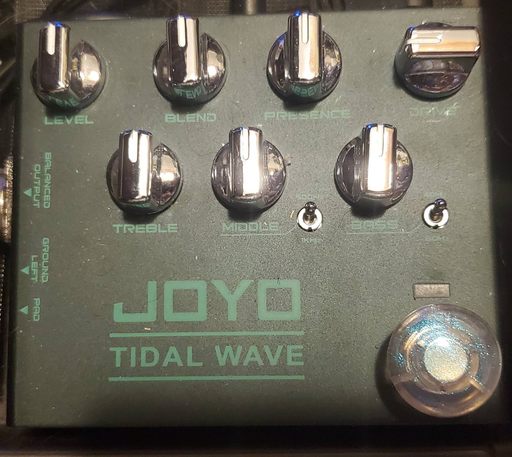
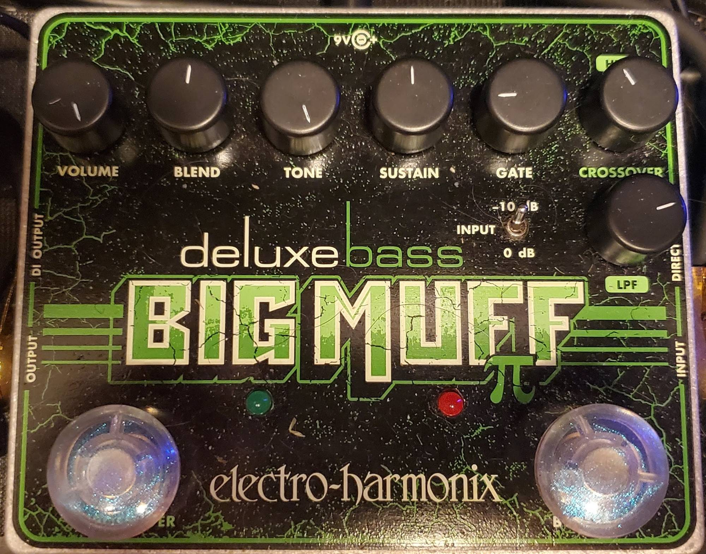
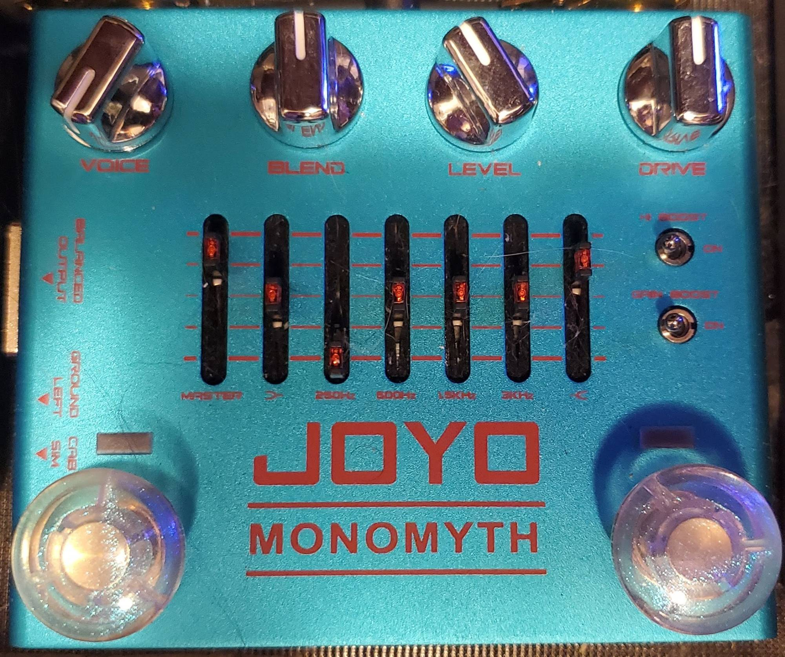
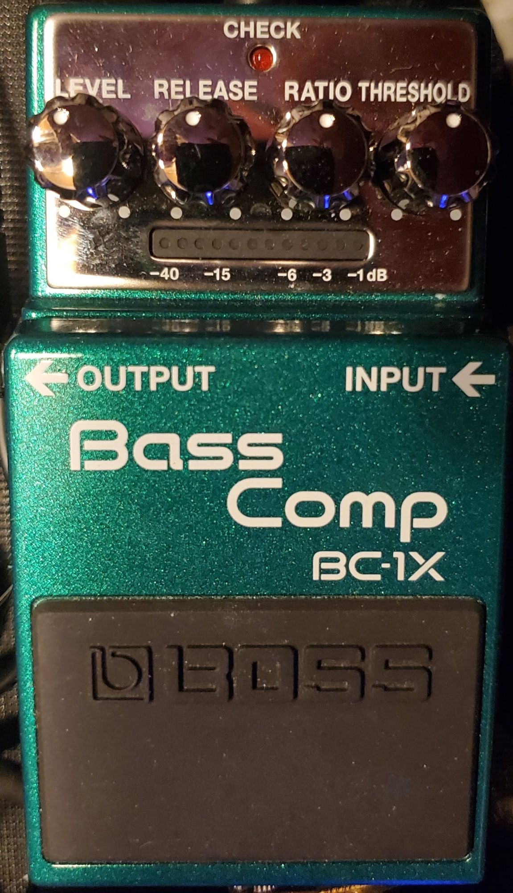
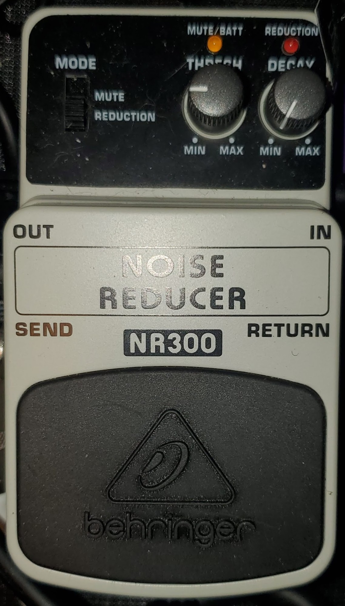

# Bass Guitar Equipment Analysis

A data repository of measured and analyzed bass guitar equipment and pedals,
primarily for use in modelling by AI.

Measured frequency responses, linearity, harmonics, noise and fitted models
for real bass-guitar equipment, made by re-amping each pedal with
exponential-sweep ladders. Written primarily for AI agents to use as
benchmark data. **Start with [`CLAUDE.md`](CLAUDE.md)**.

| equipment | what is here |
|---|---|
| [Donner EQ Seeker](data/equipment/donner-eq-seeker/) — 10-band graphic EQ | 28 takes, fitted model, findings |
| [Behringer NR300](data/equipment/behringer-nr300/) — noise gate | 8 takes, frame envelopes, fitted model |
| [Boss BC-1X](data/equipment/boss-bc1x/) — bass compressor | 12 takes, two-band model |
| [Joyo R-22 Tidal Wave](data/equipment/joyo-r22-tidal-wave/) — preamp/DI | 34 takes, drive model |
| [Joyo R-26 Monomyth](data/equipment/joyo-r26-monomyth/) — bass overdrive | 39 takes, measured topology, clipper parameters |
| [EHX Deluxe Bass Big Muff](data/equipment/ehx-deluxe-bass-big-muff/) — fuzz | 30 takes, circuit model |
| [EMG BQC](data/equipment/emg-bqc/) — onboard preamp | 23 injection sweeps |
| [Yamaha TRBX305](data/equipment/instrument-trbx305/) — the bass | string decay dataset, findings |
| [The re-amp loop](interface/) | round trip, noise, headroom, drift, Y-split |

## The pedals

The measured units themselves. The knob positions in these photos are
incidental: each take's setting is in its `measurements/` JSON.

| | | |
|:---:|:---:|:---:|
|  Joyo R-22 Tidal Wave |  EHX Deluxe Bass Big Muff |  Joyo R-26 Monomyth |
|  Boss BC-1X |  Behringer NR300 | |

Analysis code needs Python 3.10+ with numpy, scipy and soundfile.

Public domain ([Unlicense](LICENSE)).
